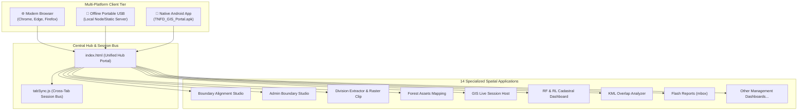

# 🌲 TNFD GIS Portal & Spatial Analytics Suite
### Integrated Web GIS Ecosystem — 14 Enterprise Spatial Applications & Mobile Portal

[](https://opensource.org/licenses/MIT)
[](https://turfjs.org/)
[]()
[]()

> **Live Production Portal**: [https://tnfd-gis-projects.vercel.app](https://tnfd-gis-projects.vercel.app)

---

## 📌 Executive Overview

The **TNFD GIS Portal & Spatial Analytics Suite** is an enterprise-grade spatial software ecosystem developed for the **Tamil Nadu Forest Department (TNFD)**. It brings together **14 high-impact, production-ready web applications** into a unified, secure portal designed for cadastral reconciliation, boundary alignment, raster image processing, asset mapping, real-time monitoring, and field operations.

The suite is engineered to operate across three deployment modes:
1. **Cloud Production Web Portal** (Automated global delivery via Vercel).
2. **100% Air-Gapped / Offline Desktop Mode** (Portable USB / Pendrive execution via local zero-install server).
3. **Standalone Android Mobile App** (Self-contained `.apk` running fully offline on field tablets and smartphones).

---

## 🗺️ Suite Catalog — The 14 Integrated Applications

| # | Application | Key Capabilities | Tech Stack |
|---|:---|:---|:---|
| **01** | **[Boundary Alignment Studio](https://tnfd-gis-projects.vercel.app/projects/Boundary_Alignment_Studio/index.html)** | Slices target geometries and conforms them to reference lines with **100% mathematical coincidence** using an ultra-fast `< 1ms` dual-bbox spatial index and 18× micro-loupe HUD. | Leaflet, Turf.js, Canvas 60FPS, shpwrite |
| **02** | **[Administrative Boundary Studio](https://tnfd-gis-projects.vercel.app/projects/admin_boundary_studio/index.html)** | Cartographic boundary generator for forest circles, divisions, and ranges with multi-format vector export and automated PDF map sheet creation. | Leaflet, jsPDF, SVG/Canvas, Turf.js |
| **03** | **[Division Extractor & Raster Clip Studio](https://tnfd-gis-projects.vercel.app/projects/division%20clip/index.html)** | In-browser spatial clipping of massive satellite imagery (LISS-IV, Sentinel-2) and LULC shapefiles by administrative division boundaries. | GeoTIFF, Canvas, Shpjs, Web Workers |
| **04** | **[Forest Assets Mapping](https://tnfd-gis-projects.vercel.app/projects/Forest_Assets_Mapping/index.html)** | Geo-tagged asset inventory, spatial verification, boundary inspection, and field infrastructure mapping. | Leaflet, GeoJSON, IndexedDB, Tailwind |
| **05** | **[GIS Live Class & Session Host](https://tnfd-gis-projects.vercel.app/projects/GIS_CLASS/index.html)** | Real-time collaborative mapping session host, remote training dashboard, and interactive spatial annotation synchronizer. | WebSockets, WebRTC, Leaflet |
| **06** | **[Reserved Forest (RF) & Reserved Land (RL) Dashboard](https://tnfd-gis-projects.vercel.app/projects/RFRL%20DASHBOARD/index.html)** | Master cadastral boundary reconciliation, gazette notification tracking, and division-wise RF/RL area analytics. | Leaflet, Chart.js, Spatial Query Engine |
| **07** | **[RF & RL Spread Sheet Verification Dashboard](https://tnfd-gis-projects.vercel.app/projects/RFRL%20spread%20Sheet%20%20dashboard/index.html)** | Tabular data reconciliation, KML spatial boundary validator, and CSV-to-Map synchronizer. | SheetJS (XLSX), PapaParse, Leaflet |
| **08** | **[KML Overlap Analyzer](https://tnfd-gis-projects.vercel.app/projects/KML_Overlap_Analyzer/index.html)** | Multi-polygon collision detection, spatial overlap percentage calculation, and topological sliver extraction. | Turf.js (intersect/union/difference) |
| **09** | **[Flash Reports Monitoring (mbox)](https://tnfd-gis-projects.vercel.app/projects/mbox/index.html)** | Real-time forest fire alerts, emergency wildlife incident tracking, and flash report monitoring system across all circles. | Leaflet, Real-time JSON Feed, Chart.js |
| **10** | **[Urgent Issues Monitoring Portal](https://tnfd-gis-projects.vercel.app/projects/URGENT%20ISSUES%20MONITORING/index.html)** | Head Office executive dashboard for high-priority forest land issues, court cases, and division accountability tracking. | Vanilla JS, LocalStorage, CSS3 Grid |
| **11** | **[IT Wing Important Issue Monitoring System](https://tnfd-gis-projects.vercel.app/projects/IT%20WING-%20IMPORTANT%20ISSUE%20MONITORING%20SYSTEM/index.html)** | Centralized IT infrastructure ticket escalation, hardware breakdown reporting, and resolution tracking. | HTML5, Tailwind, LocalStorage |
| **12** | **[IT Equipments Dashboard](https://tnfd-gis-projects.vercel.app/projects/IT_Equipments_Dashboard/index.html)** | Comprehensive hardware inventory registry, division-wise allocation, and warranty tracking of GIS workstations & GPS devices. | DataTables, Chart.js, HTML5 |
| **13** | **[Meeting Schedule Dashboard](https://tnfd-gis-projects.vercel.app/projects/Meeting_Dashboard/index.html)** | One-view slot coordination, officer availability calendar, and senior management meeting manager. | FullCalendar, LocalStorage, Vanilla JS |
| **14** | **[Requirement Dashboard](https://tnfd-gis-projects.vercel.app/projects/Requirment%20Dashboard/index.html)** | Division-wise GIS hardware and field requirement compiler with multi-circle aggregation and Excel export. | SheetJS, Responsive Tables, Modern UI |

---

## 🏗️ System Architecture



---

## ⚡ Technical & Engineering Highlights

### 1. Zero-Backend Serverless Architecture
Every single application in this suite runs **100% in-browser on client hardware**. No cloud backend or proprietary GIS servers are required. This ensures:
* **Zero Infrastructure Cost**: Operates anywhere without cloud hosting expenses.
* **Maximum Security**: Sensitive state boundary geometries and cadastral shapefiles never leave the user's local machine.

### 2. High-Performance Spatial Indexing & 60 FPS Rendering
* **Spatial-Grid Segment Indexing**: Custom dual-bbox algorithm drops polygon intersection queries from $O(N \times M)$ (35 seconds) to $O(1)$ (< 1 millisecond).
* **HTML5 Canvas Vector Pipeline**: Replaces heavy SVG DOM elements with single-pass Canvas rendering, sustaining 60 FPS under massive multi-polygon loads.

### 3. Universal GIS Multi-Format Support
* **Input Formats**: ESRI Shapefiles (`.shp`, `.shx`, `.dbf`, `.prj`), Google Earth KML (`.kml`), Compressed KMZ (`.kmz`), GeoJSON.
* **Output Formats**: In-browser generation of valid ESRI Shapefile `.zip` packages, clean KML, KMZ, and high-DPI printable PDF maps.

### 4. Cross-Tab Session Synchronization (`tabSync.js`)
* Uses browser `BroadcastChannel` and `localStorage` events to allow open tabs to coordinate active division selections, layer filters, and shared coordinates without requiring network roundtrips.

---

## 🚀 Deployment & Usage Modes

### Mode A: Cloud Web Deployment
Access the full suite live from any device with zero installation:  
👉 **[https://tnfd-gis-projects.vercel.app](https://tnfd-gis-projects.vercel.app)**

### Mode B: 100% Offline Desktop Mode (USB / Pendrive)
1. Copy the `GIS_Projects` folder onto any USB drive or local computer.
2. Double-click **`Start_Desktop_Portal.bat`**.
3. It launches a local HTTP server and opens `http://localhost:8080` in your default browser.
   *(No internet connection or Node.js installation required — falls back to direct browser launch).*

### Mode C: Standalone Android App
* Install **`TNFD_GIS_Portal.apk`** on any Android phone or tablet.
* All 14 applications are pre-compiled into local device assets (`file:///android_asset/`), enabling full offline field GIS capability.

---

## 💻 Local Setup & Quickstart

```bash
# 1. Clone this repository
git clone https://github.com/Shashank-jpg-cpu/TNFD-GIS-Projects.git

# 2. Enter project directory
cd TNFD-GIS-Projects

# 3. Launch local static server (or double-click Start_Desktop_Portal.bat on Windows)
npx serve .
# Or using Python:
python -m http.server 8080
```
Then navigate to `http://localhost:8080`.

---

## 👨‍💻 Author & Contact

**Shashank Kusugal**  
* GIS Specialist & Spatial Data Engineer  
* Email: [shashankkusugal70@gmail.com](mailto:shashankkusugal70@gmail.com)  
* GitHub: [@Shashank-jpg-cpu](https://github.com/Shashank-jpg-cpu)  

---

*Engineered for modern spatial data infrastructure, boundary harmonization, and enterprise forestry workflows.*
