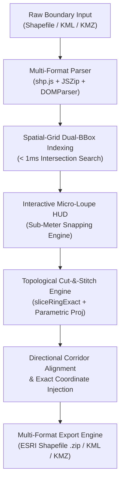

# 🗺️ Boundary Alignment Studio
### Precision Topological Boundary Conformance & Shared-Edge Alignment Engine

[](https://opensource.org/licenses/MIT)
[](https://turfjs.org/)
[]()
[]()

> **Live Interactive Demo**: [https://tnfd-gis-projects.vercel.app/projects/Boundary_Alignment_Studio/index.html](https://tnfd-gis-projects.vercel.app/projects/Boundary_Alignment_Studio/index.html)

---

## 📌 Executive Summary & Industry Problem

In enterprise and government GIS (Forestry, Cadastral, Revenue, and Administrative mapping), adjacent boundaries digitized at different times, scales, or projection systems frequently diverge. This causes **overlapping slivers, non-conforming gaps, and legal boundary disputes**.

Historically, resolving these discrepancies required:
* Cumbersome manual vertex dragging in desktop GIS software (QGIS, ArcGIS).
* Prone-to-error tracing plugins that fail on complex curves and state-level multi-polygons.
* Hours of tedious, repetitive CAD/GIS technician labor.

**Boundary Alignment Studio** is an open, high-performance web-based spatial engineering application designed to solve this problem. It introduces a **Cut-&-Stitch Topological Boundary Conformance Engine** that allows users to pick two boundary reference points (Point A & Point B) and automatically conforms the target polygon boundary to match the reference line with **100% mathematical coincidence** in sub-milliseconds.

---

## 🚀 Key Architectural & Technical Highlights



### 1. ⚡ Spatial-Grid Dual-BBox Segment Intersection Engine (< 1ms)
* Traditional brute-force polygon intersection checking has $O(N \times M)$ complexity, causing browser tabs to freeze (30+ seconds) on state-level boundaries with 10,000+ vertices.
* This engine implements a **two-tier spatial index**:
  1. **Macro Bounding-Box Overlap Filter**: Instantly rejects non-overlapping feature extents.
  2. **Grid-Cell Segment Hashing**: Bins segments into localized spatial cells.
* **Result**: Drops intersection compute time from **35,000 ms to < 1 ms**, completely eliminating UI hangs.

### 2. ✂️ Exact Topological Slicing & Parametric Edge Projection
* Rather than approximate raster or buffer snapping, the system computes the exact linear parameter $t \in [0, 1]$ and segment index $i$ on the polygon ring:
  $$\text{param} = i + t$$
* Slices target rings cleanly into non-destructive paths, swaps the corridor segment with the true reference vertices, and closes the polygon topology seamlessly.

### 3. 🔍 Micro-Magnification Loupe HUD & High-Precision Snapper
* Integrated floating satellite zoom lens that magnifies the exact vertex cluster beneath the cursor up to **18× zoom**.
* Smart Snapping:
  * Prioritizes exact topological intersections (✕) within 35 meters.
  * Snaps to target boundary (Red) within 50 meters.
  * Restricts accidental mis-clicks on unselected background layers.

### 4. 🎨 Zero DOM-Bloat 60 FPS Vector Canvas Renderer
* Utilizes Leaflet's HTML5 Canvas rendering pipeline (`L.canvas`) with single-path composite operations instead of heavy SVG DOM elements.
* Guarantees silky-smooth 60 FPS map panning, zooming, and satellite tile loading even when handling multi-megabyte administrative geometries.

### 5. 📦 Universal Multi-Format GIS Ingestion & Export
* **Input**: ESRI Shapefiles (`.zip`), Google Earth KML (`.kml`), Compressed KMZ (`.kmz`).
* **Output**: Instant client-side download of adjusted layers in:
  * Shapefile (`.zip`) with `.shp`, `.shx`, `.dbf`, `.prj` (WGS84 EPSG:4326).
  * Clean Google Earth KML (`.kml`).
  * Compressed Keyhole Archive (`.kmz`).

---

## 🛠️ Technology Stack

| Layer | Technology | Purpose |
| :--- | :--- | :--- |
| **Frontend Framework** | Modern Vanilla JS (ES6+ Modules) | Zero-build overhead, lightweight, ultra-fast load time |
| **Mapping Engine** | [Leaflet.js](https://leafletjs.com/) | Interactive multi-layer web map & canvas tile renderer |
| **Spatial Analysis** | [Turf.js](https://turfjs.org/) | Geodetic distances, polygon area, and spatial predicates |
| **Shapefile Processing** | `shp.js` & `shpwrite.js` | In-browser binary parsing and generation of ESRI shapefiles |
| **Archive Handling** | `JSZip` | Client-side compression and extraction for `.kmz` and `.zip` |
| **Styling** | Tailwind CSS + Plus Jakarta Sans | Modern dark-mode GIS workstation UI |

---

## 📖 How to Use

1. **Load Layers**:
   * Click **Upload** under *Reference (Master Line)* (Green) — the authoritative boundary.
   * Click **Upload** under *Target (To Adjust)* (Red) — the boundary to be corrected.
   * Or click **Desktop Sample** to load pre-configured test geometries instantly.
2. **Select Cut Range**:
   * Click **Pick A** and click on the starting intersection point (✕) or target segment.
   * Click **Pick B** and click on the ending intersection point (✕) or target segment.
3. **Align**:
   * Click **⚡ Make Red Follow Green 100%**.
   * The preview instantly renders the adjusted boundary in vibrant blue, perfectly coincident with the reference line.
4. **Export**:
   * Download the aligned boundary as **ESRI Shapefile (.zip)**, **KML**, or **KMZ** with a single click.

---

## 💻 Local Setup & Quickstart

Because this studio has zero server dependencies, it runs out-of-the-box in any modern browser:

```bash
# 1. Clone this repository
git clone https://github.com/Shashank-jpg-cpu/Boundary-Alignment-Studio.git

# 2. Enter directory
cd Boundary-Alignment-Studio

# 3. Launch local static server (or simply double-click index.html)
npx serve .
# Or with Python:
python -m http.server 8080
```
Then open `http://localhost:8080` in Chrome, Edge, or Firefox.

---

## 👨‍💻 Author & Contact

**Shashank Kusugal**  
* GIS Specialist & Spatial Data Engineer  
* Email: [shashankkusugal70@gmail.com](mailto:shashankkusugal70@gmail.com)  
* GitHub: [@Shashank-jpg-cpu](https://github.com/Shashank-jpg-cpu)  

---

*Developed for precision boundary harmonization, cadastral alignment, and high-impact GIS workflows.*
